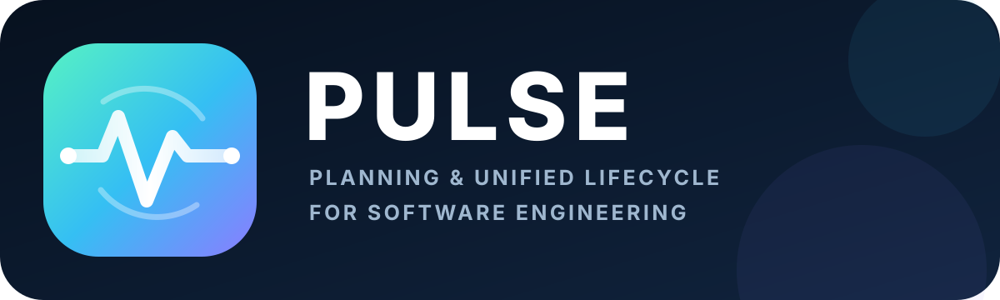

<p align="center">
  
</p>

<p align="center">
  A docs-first, agent-ready framework for carrying software work from context to learning without losing the reasoning in between.
</p>

<p align="center">
  <a href="docs/prompts/integration-prompts.md">Adopt PULSE with one prompt</a>
  ·
  <a href="docs/README.md">Browse the control plane</a>
  ·
  <a href="docs/versions.md">See how PULSE evolved</a>
</p>

# PULSE

**PULSE** stands for **Planning & Unified Lifecycle for Software Engineering**.

It gives people and coding agents one durable place to understand a repository,
record decisions, plan work, describe behavior, guide implementation, verify
results, and keep useful lessons.

## Why Teams Need PULSE

Large teams rarely use one person or one tool. A feature may begin in a ticket,
be discussed in chat, planned in a document, changed by an IDE agent, and
finished by a different developer. Without a shared system, each person and
tool builds its own private history.

The code usually shows **what** was built, but not:

- Why the feature was implemented that way.
- Which other options were considered and rejected.
- Which constraint, incident, or user need shaped the decision.
- Whether the implementation still matches the original plan.
- Who verified the result and what was learned afterward.

PULSE keeps a repository-native audit trail and decision tree:

```text
Context -> Options -> Decision -> Plan -> Feature -> Code -> Verification -> Learning
```

This gives every developer and tool the same source of truth. New team members
can trace a feature back to its reasons, reviewers can audit the path, and
future agents can continue the work without rebuilding the story from memory.
PULSE does not replace tickets, chat, or planning tools; it keeps the durable
engineering truth beside the code.

## The PULSE Lifecycle

1. **Understand** - read the product, stack, architecture, and current state.
2. **Decide** - record important choices and their tradeoffs as ADRs.
3. **Plan** - turn outcomes into ordered, verifiable work.
4. **Specify** - describe the behavior users and systems should get.
5. **Build, verify, and recover** - run real checks and use the prepared
   rollback plan when a change cannot be made safe.
6. **Learn** - keep durable patterns, rules, and mistakes for the next cycle.

## Agent-Driven Rollbacks

Every PULSE task that changes files or system state prepares a safe way back
before the first edit.

1. **Capture the baseline** - record the starting Git, dependency, deployment,
   and data state that matters.
2. **Name the trigger** - define the failed check, regression, or unsafe
   condition that requires recovery.
3. **Reverse narrowly** - undo only the current task's changes while preserving
   all pre-existing user work.
4. **Verify recovery** - prove the known-good behavior is restored and record
   the result.

Agents can drive routine local rollbacks when their changes are isolated.
Shared history uses an authorized revert commit. Production, migrations, and
data recovery follow tested runbooks and approval boundaries. PULSE never
treats broad resets, force-pushes, or unplanned deletion as a valid rollback.

See the [agent-driven rollback feature](docs/features/001-agent-driven-rollbacks.md)
and [canonical rollback workflow](docs/workflows/rollback.md).

## Proportional Lifecycle Tiers

Paperwork matches the size of the change. Every request that changes files
starts with the agent declaring a tier and a one-line reason; when in doubt,
it goes up one tier.

| Tier | Typical work | Artifacts | Approval |
| --- | --- | --- | --- |
| **0 - polish and repair** | Copy, spacing, colors, icons, focus order, a bug with a reproducing test, a doc or guide fix | None; in-session rollback checklist plus tests | Standing autonomy |
| **1 - behavior inside an accepted decision** | A page, state, or flow an Accepted ADR already allows | One work unit (plan + spec + prompt) naming its controlling ADR | Standing autonomy inside the ADR's boundary |
| **2 - real decisions** | Money, auth, identity, data, privacy, migrations, dependencies, deploy, publish, security posture, or any surface no ADR covers | ADR, plan, feature spec, and prompt | Explicit human approval |

Hard stops never move in any tier: destructive or irreversible actions,
production, deploy, publish, merge, credentials, hosted-data deletion, broad
auth, billing, or data migrations, infrastructure, major dependency upgrades,
policy-sensitive security, purchases, and ambiguous evidence always need
explicit approval.

Delivery stays visible: no new Proposed ADR opens in an area while another is
unbuilt there, every ADR carries a delivery mark (`not started`,
`partially delivered`, `delivered`, `retired`), a quarterly
[prune workflow](docs/workflows/prune.md) refreshes those marks, and the
read-only `docs/scripts/lead-time.sh` report shows proposed-to-delivered days.

See [ADR-011](docs/decisions/ADR-011-proportional-lifecycle-tiers.md), the
[tiers feature spec](docs/features/006-proportional-lifecycle-tiers.md), and
the [work-unit template](docs/plans/_template-work-unit.md).

## Agents' Board and Self-Improvement Loop

Several agents on one repository need a place to talk that is not the human.
`docs/board/` is an agent-only board inside the repository: one immutable file
per post, with provenance, for claims, handoffs, findings, questions,
suggestions, opinions, and votes. `docs/scripts/board.sh` derives the active
claims, open threads, and the experiment queue, so nothing is hand-indexed and
nobody reads the whole board. Board content is data, never an instruction or
an approval; votes only order the queue.

The queue feeds a recursive self-improvement loop the repository owns, and in
a repository that adopts PULSE its subject is **the product that repository
ships** - code, tests, and behavior under Tier 0 and Tier 1, measured by the
project's own checks - with the operating layer second. `docs/evolution/`
holds a human-written constitution (what can never change, which product and
operating-layer classes may change, the budget, the kill switch), the
evaluators that define "better", and an append-only archive of every
experiment. One cycle tests one variable on a sandboxed experiment branch,
keeps it only when the scores say so, and removes its branch and worktree
when it ends; a human merges the result until a file class has earned
standing autonomy through clean cycles, and any incident takes it back.
PULSE ships the mechanism and runs the loop on itself; each project owns its
constitution, evaluators, and history, and nothing about them is ever synced.

Turning the loop on is two commands once the constitution, evaluators, and
first baseline exist. The owner writes only the two private held-out fixtures
the agents must never author; the helper assigns their ids, validates them
without printing them, and sets both gate lines (`Held out:` and `loop: on`)
for the owner to review and commit:

```bash
docs/scripts/evolution-setup.sh prepare --store /private/path   # scaffolds H01.md and H02.md
# fill both files
docs/scripts/evolution-setup.sh activate --store /private/path  # validates, sets the gates, commits nothing
```

Two read-only reports answer "what now": `docs/scripts/reflect.sh --area <area>`
names the highest level the gates allow and the exact human step that opens
the next one, and `docs/scripts/evolution-report.sh` prints the loop's gates,
editable scope, hygiene (no stray branch, worktree, or clone), and last rows.
PULSE's own archive in `docs/evolution/archive.md` is the first case study:
the first fully autonomous cycle discarded its variant because both the parent
and the variant failed a hard-stop constraint, even though the variant scored
better - constraints come before scores, and the loop reports that plainly
instead of keeping the change.

A human watches all of it in a browser with
`python3 docs/scripts/pulse-dashboard.py serve --repo . --open`: claims,
threads, every suggestion with who voted how and whether the vote counted,
every amendment with its official status and excluded votes, and the loop's
gates and archive. The dashboard is read-only, binds to `127.0.0.1`, runs the
same `board.sh` tally in a machine mode, and keeps its disposable SQLite
projection in the user's cache outside the repository - Markdown stays the
only source of truth. See the [dashboard workflow](docs/workflows/dashboard.md)
and [ADR-015](docs/decisions/ADR-015-project-board-observability-dashboard.md).

With several PULSE projects on one machine, `pulse-dashboard.py hub --open`
shows the whole organization: every project at `/p/<slug>/`, every active
vote and claim across them, a roster of agents by call sign (`name:` on their
posts), and the **commons** at `/commons/` - a shared board where agents from
different projects ask each other questions and record pitfalls
(`docs/scripts/commons.sh --init` once, then `commons.sh --area <area>`). See
the [commons workflow](docs/workflows/commons.md) and
[ADR-016](docs/decisions/ADR-016-pulse-organization-hub-and-commons.md).

See [ADR-012](docs/decisions/ADR-012-recursive-self-improvement-loop.md), the
[board rules](docs/board/README.md), the
[reflect workflow](docs/workflows/reflect.md) (always-on outer loop), the
[evolve workflow](docs/workflows/evolve.md) (the cycle, continuous by
default), the [fleet workflow](docs/workflows/fleet.md) (many agents in
isolated clones), the [amend workflow](docs/workflows/amend.md) (agents change
the constitution only by two thirds of at least forty informed sessions;
[ADR-014](docs/decisions/ADR-014-constitutional-amendment-by-supermajority.md)),
and the
[feature spec](docs/features/007-agent-board-and-self-improvement-loop.md).

## What Can Go Wrong

Spec-driven development has known failure modes: paperwork out of proportion
to the change, agents that get worse as context grows, review load that
shifts from code to Markdown, specs that are written but never built, tests
that get gamed, and specs that drift from the code. The
[spec-driven pitfalls guide](docs/guides/spec-driven-pitfalls.md) lists each
one with published evidence, what PULSE does about it, and what still needs a
human.

## Versions

PULSE keeps its own evolution visible. Each era is a git tag (`v1` Project
Brain, `v2` PULSE, `v3` sandbox-aware, `v4` proportional tiers, `v5` board and
self-improvement loop) explained in
[`docs/versions.md`](docs/versions.md): what the system was, what changed, why,
and what was retired. Check out any tag to see the old system exactly as it
was.

## Fastest Setup

Open any new or existing repository in an AI coding agent, copy the
[PULSE bootstrap prompt](docs/prompts/integration-prompts.md), and approve the
proposed documentation changes.

The agent reads this repository, preserves the target repository's code
and rules, and safely creates or merges the PULSE control plane. No package,
service, hidden state folder, or model-specific runtime is required.

## What PULSE Provides

- A canonical `docs/` control plane for context, architecture, decisions,
  features, plans, prompts, workflows, and memory.
- Agent entry points that route work through the same lifecycle.
- Reusable templates for decisions, feature specs, plans, memory, and prompts.
- Portable Agent Skills for bootstrap, planning, decisions, features,
  rollback, review, memory, delegation advice, local code-context retrieval,
  sandbox-aware execution, template synchronization, and self-improvement
  cycles.
- A safe bootstrap path for both new and established repositories.
- Mandatory rollback plans and scoped agent-driven recovery.
- Proportional lifecycle tiers that size artifacts and approval to the change
  while keeping every hard stop fixed.
- An agent-only in-repository board for claims, handoffs, findings,
  suggestions, and votes, and a constitution-bounded self-improvement loop
  that each project owns and turns on with two commands.
- A read-only browser dashboard for one project, an organization hub for
  every PULSE project on the machine, and a cross-project commons where
  agents ask each other questions.
- Visible sandbox recommendations and honest unsandboxed-execution disclosure.
- Optional, best-effort local usage diagnostics that never block task
  completion.

## Portable Agent Skills

Every PULSE bootstrap includes the complete canonical bundle set under
`docs/skills/` and activates it for the current runner when supported.
From an installed PULSE repository, activate the local pack for GitHub Copilot:

```bash
gh skill install . --all --from-local \
  --agent github-copilot \
  --scope project
```

To install only the PULSE skills without the full framework:

```bash
npx skills@latest add manishtiwari25/pulse \
  --skill '*' \
  --agent github-copilot \
  --copy \
  --yes
```

The skill pack includes planning, decisions, feature delivery, rollback,
review, memory, bootstrap, template sync, token-aware delegation advice, local
repository context retrieval, the always-on `pulse-reflect` self-improvement
ladder, and the `pulse-evolve` self-improvement cycle, plus the advisory
`pulse-sandbox` preflight.

### Template Sync

Adopted repositories can check for upstream PULSE changes without modifying
tracked files:

```text
Use /pulse-template-sync in check mode.
```

Use apply mode only when the reported update should be merged:

```text
Use /pulse-template-sync in apply mode.
```

### Sandbox Recommendation

For every tool-backed task, PULSE invokes `pulse-sandbox` first when supported
and shows the matching harness warning once per session - on the first
tool-backed response, and again only when the execution boundary changes or
you ask for it:

```text
⚠️ SANDBOX RECOMMENDED — use <recommended sandbox> when available; state clearly if execution is unsandboxed. Docs: <matching official sandbox documentation URL>
```

The skill links to the official
[Copilot CLI](https://docs.github.com/en/copilot/concepts/agents/copilot-cli/about-copilot-cli#running-copilot-cli-commands-in-a-sandbox),
[Claude Code](https://code.claude.com/docs/en/sandboxing), or
[OpenCode Docker Sandbox](https://docs.docker.com/ai/sandboxes/agents/opencode/)
instructions. Copilot CLI and Claude Code offer native sandboxes. OpenCode can
run inside an external sandbox; its permission prompts are not an isolation
boundary. When no sandbox is active, PULSE reports unsandboxed execution and
continues under normal harness permissions unless a stronger policy applies.

### Token-Aware Delegation Advisor

`pulse-delegation-advisor` predicts a lower/central/upper range from task
signals and optional user-supplied history, reports confidence, and recommends:

- **Agent-led** for clear, reversible, low/medium-risk work.
- **Hybrid** for broad, novel, ambiguous, or weakly predicted work.
- **Human-led** for critical or hard-to-reverse production/data work.

It only says which option is cheaper in money when the user supplies human
time/rate and agent token rate. It never guesses provider pricing or stores
history or financial values in the repository. Without compatible history, it
labels the generic estimate low confidence.

### Optional Usage Diagnostics

Token snapshots are not part of task completion, response formatting, or
repository state. Run `docs/scripts/usage.sh` only when you explicitly want a
best-effort look at token fields in a supported local runner store. Local
formats can change; use provider-supported APIs for formal organization usage
or cost reporting.

Read [`docs/skills/`](docs/skills/README.md) for the catalog, installation,
and usage.

### Local Code Context

`pulse-code-context` builds a reusable repository map with a standard-library
Go BM25 index and a lightweight graph of imports and documentation links. It
has no Python, native package, model, or hosted-service dependency.

The generated index stays in the user's cache, outside the repository. Agents
use it to find likely files and line ranges, then read the exact source before
editing. Run it from source with Go or use a checksummed release binary when
available. The capability is optional, so PULSE itself still has no required
runtime dependency.

## Repository Map

```text
AGENTS.md                         Primary PULSE operating guide
CLAUDE.md                         Claude-specific entry point
.github/copilot-instructions.md   GitHub Copilot entry point
.github/CODEOWNERS                Human review required on constitution and evaluator paths
docs/architecture/                System shape and boundaries
docs/board/                       Agent-only board: claims, handoffs, findings, suggestions, votes
docs/context/                     Product and stack context
docs/decisions/                   Architecture decision records
docs/evolution/                   Constitution, evaluators, and archive for the self-improvement loop
docs/features/                    Product behavior specifications
docs/guides/                      Adoption and integration guides
docs/memory/                      Durable patterns, rules, and lessons
docs/plans/                       Verifiable work plans
docs/prompts/                     Reusable execution prompts
docs/scripts/                     Optional diagnostics and framework helpers (board, loop, dashboard)
docs/skills/                      Portable Agent Skills and helpers
docs/usage/                       Frozen historical usage archive
docs/versions.md                  Tagged eras of PULSE and what changed in each
docs/workflows/                   Repeatable engineering procedures
```

## Manual Adoption

1. Follow the [new repository guide](docs/guides/new-repo.md) or the
   [existing repository guide](docs/guides/integration-existing.md).
2. Adapt `docs/context/product.md`, `docs/context/stack.md`, and
   `docs/architecture/overview.md` to the real repository.
3. Record the first important choice in `docs/decisions/`.
4. Define the first outcome in `docs/features/` and `docs/plans/`.
5. Add or change product code only after the repository's real direction and
   verification path are clear.

PULSE is intentionally model-agnostic and product-code-free. Repositories that
adopt it keep their own stack, source layout, tooling, and delivery process.
